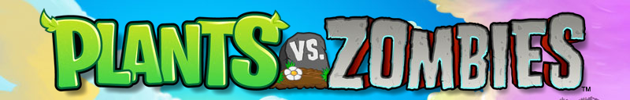

# Plants vs. Zombies



A browser-based tower defense fan project with six adventure stages. Collect sun, place plants to defend each lane, and claim rewards to unlock new seeds.

## Run locally

You'll need Node.js 18.3 or later, npm, and a modern browser.

```bash
git clone https://github.com/mmdbazooka/Plants-vs-Zombies.git
cd Plants-vs-Zombies
npm ci
npm run api
```

Leave the API running on port 3000. From a second terminal in the same folder, run:

```bash
npm run dev
```

Open [the game at localhost:5173](http://localhost:5173).

## How to play

1. Select **Start Adventure** from the main menu. Choose your seeds and select **Let's Rock**.
2. Click falling sun to collect it. Select a seed card, then click an empty lawn tile to plant it. Use the shovel to clear a tile.
3. Defeat every zombie and click the reward to advance. If a zombie reaches the house, select **Try Again** to restart the stage.

Choose **Easy**, **Normal**, or **Hard** under **Options**. Compared with Normal, Hard doubles the zombie count, halves the time between spawns, and increases zombie movement speed by 50%.

Open **Customize Zombie** from the main menu to change its appearance and save it. Once you have a saved design, each spawn has a 50% chance of using a randomly selected saved design.

Use **Fullscreen** in the bottom-right corner to fit the game to your display. Press **Esc** to exit.

## Build and preview

```bash
npm run build
npm run preview
```

Keep the API running and open [the production preview at localhost:4173](http://localhost:4173).

The frontend uses React, React Router, Vite, and Tailwind CSS. JSON Server stores adventure progress and unlocked plants in `src/core/services/dataBase/db.json` and serves the game's sound settings. Zombie designs are saved in your browser.
